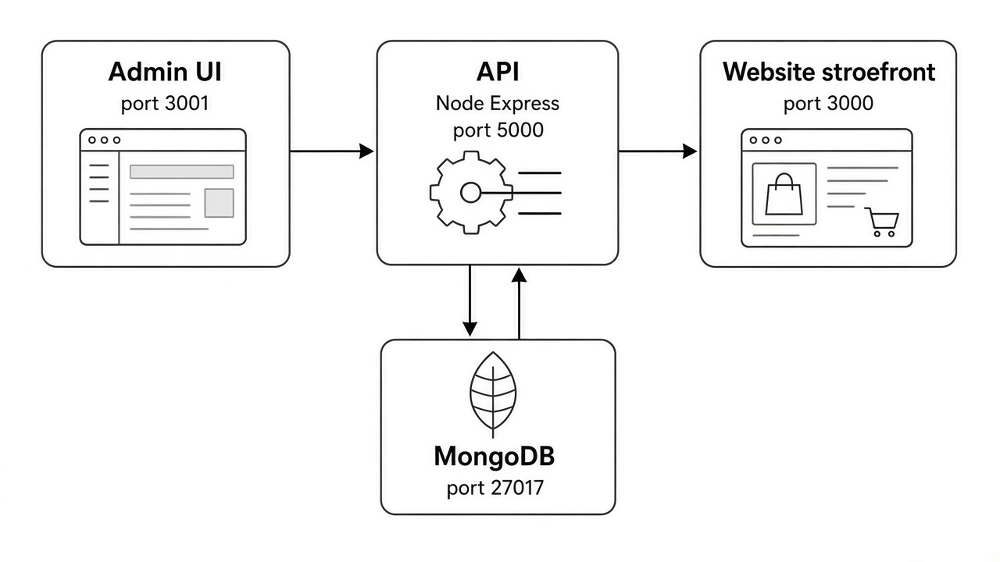
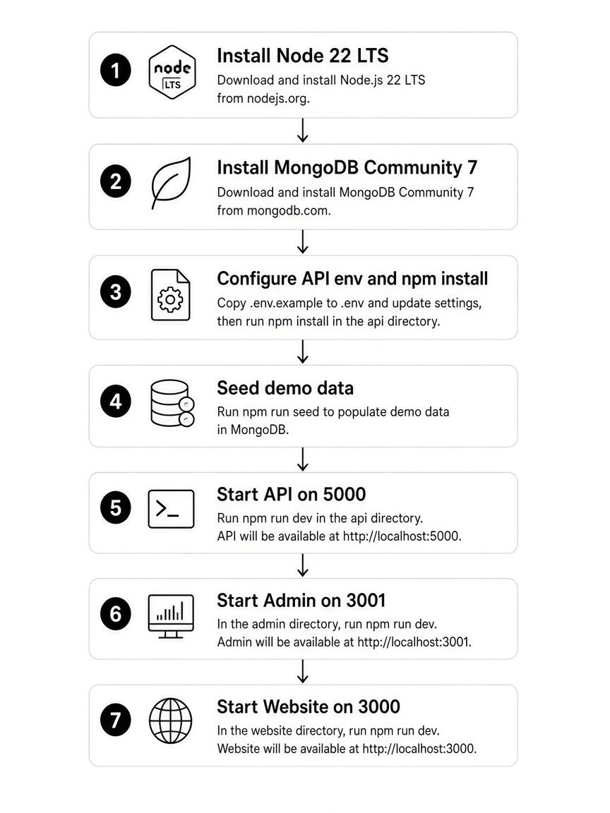
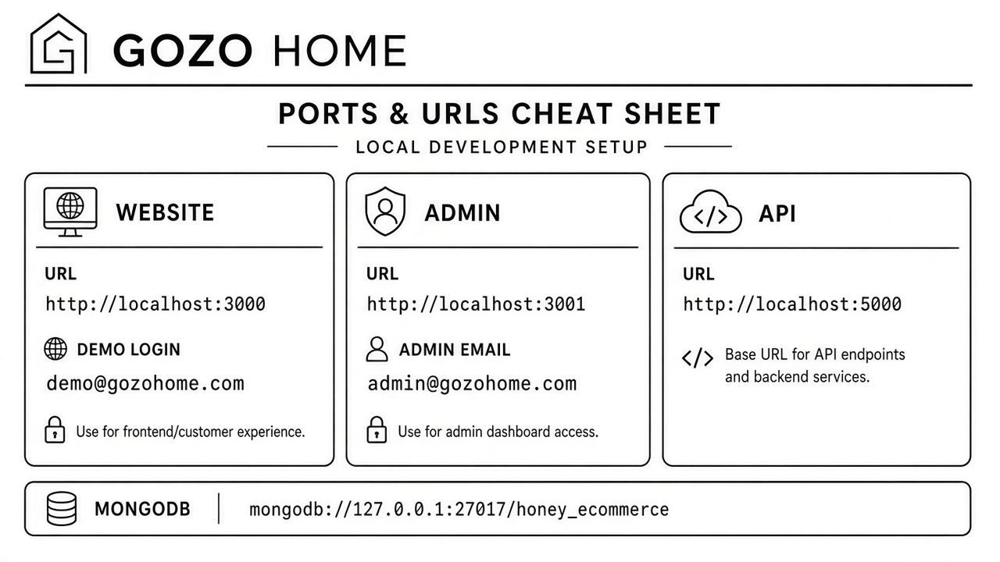

# GOZO HOME — Local run guide (from scratch)

Picture-style guide to install and run **API**, **Website**, and **Admin** on a developer machine (Windows / macOS / Linux).

Brand: **GOZO HOME** — THE JOY OF DECORS CRAFTED.

---

## 0) What you have

After unzipping the source package you should see:

```text
START_HERE.md                 ← open this first
CLIENT_LOCAL_RUN.md           ← this file
docs/client-guide/images/     ← diagrams for this guide
original_partyBox_new_api/    ← API (backend)
original_HoneyEcommerce_new_ui/  ← Website (storefront)
Honey_admin_UI/               ← Admin panel
scripts/make-client-source-zip.sh
```



| # | App | Folder | Port | Opens in browser |
|---|-----|--------|------|------------------|
| 1 | **API** | `original_partyBox_new_api` | **5000** | Health/JSON only (not a website) |
| 2 | **Website** | `original_HoneyEcommerce_new_ui` | **3000** | http://localhost:3000 |
| 3 | **Admin** | `Honey_admin_UI` | **3001** | http://localhost:3001 |

You need **three terminals** once everything is installed (API + Website + Admin). MongoDB runs as a background service.



---

## 1) What to install (once per computer)

### 1.1 Node.js — **required version: 22 or newer**

All three projects declare `"engines": { "node": ">=22" }`.

| Item | Version |
|------|---------|
| **Node.js** | **22 LTS** (recommended) or any **≥ 22** |
| **npm** | Comes with Node (npm **10.x** is fine) |

**Check:**

```bash
node -v    # must show v22.x or higher (example: v22.23.4)
npm -v     # example: 10.9.9
```

**Install:**

- Windows / macOS: download **Node.js 22 LTS** from https://nodejs.org/
- macOS (Homebrew): `brew install node@22`
- Ubuntu/Debian:

```bash
# Example using NodeSource / nvm — pick one approach your team prefers
# With nvm:
curl -fsSL https://raw.githubusercontent.com/nvm-sh/nvm/v0.40.1/install.sh | bash
# restart terminal, then:
nvm install 22
nvm use 22
```

> Do **not** use Node 18 or 20 for this project. Vite 8 (admin) and current dependencies expect Node 22+.

### 1.2 MongoDB Community — **required**

| Item | Version |
|------|---------|
| **MongoDB Server** | **7.0** Community (recommended). **6.0** or **8.0** also work |
| **Default listen** | `127.0.0.1:27017` |
| **Database name** | `honey_ecommerce` (created automatically on first seed) |

**Check:**

```bash
# service should be running; either works depending on install:
mongosh --eval "db.runCommand({ ping: 1 })"
# or older:
mongo --eval "db.runCommand({ ping: 1 })"
```

**Install (pick your OS):**

- Windows: MongoDB Community MSI — https://www.mongodb.com/try/download/community  
  Keep “Install as a Service” checked.
- macOS: `brew tap mongodb/brew && brew install mongodb-community@7.0 && brew services start mongodb-community@7.0`
- Ubuntu: follow MongoDB 7.0 Community install docs, then `sudo systemctl start mongod`

Optional GUI: **MongoDB Compass** (same download page) — useful to see collections after seed.

### 1.3 Redis — **optional (skip for local)**

Local `NODE_ENV=development` **skips Redis** automatically. You do **not** need to install Redis for the demo.

Only set `SKIP_REDIS=1` if you run with `NODE_ENV=production` locally without Redis.

### 1.4 Git (optional)

Only needed if you clone from GitHub instead of using the zip. Any recent Git is fine.

### 1.5 Code editor (optional)

VS Code / Cursor — not required to run.

---

## 2) API — `original_partyBox_new_api`

Backend: **Express + Mongoose**, Node **≥ 22**, MongoDB.

### Versions used by this app

| Dependency | Declared / used |
|------------|-----------------|
| Node | `>=22` |
| Express | `^4.19` |
| Mongoose | `^8.9` |
| Excel bulk upload | `exceljs`, `xlsx`, `adm-zip`, `multer`, `sharp` |

### 2.1 Create `.env`

```bash
cd original_partyBox_new_api
cp .env.example .env
```

Minimum local `.env` (already matches `.env.example`):

```env
PORT=5000
JWT_SECRECT=local-dev-jwt-secret
MONGODB_URI=mongodb://127.0.0.1:27017/honey_ecommerce
DATABASE_NAME=honey_ecommerce
LOG_BACKUP=15d
NODE_ENV=development
DASHBOARD_URL=http://localhost:5000/
API_URL=http://localhost:5000/
APP_SECRECT_KEY=local-dev-secret
TOKEN=
```

**Rules:**

- `API_URL` and `DASHBOARD_URL` must be the **API** host (`http://localhost:5000/`), **not** the admin or website URL.
- Do **not** end `API_URL` with `/public`.
- `APP_SECRECT_KEY` must match the Website `VITE_SECRECT_KEY` (same string).
- `JWT_SECRECT` is required — without it, login may succeed with HTTP 200 but return **no token**.

### 2.2 Install packages

```bash
cd original_partyBox_new_api
npm install
```

`prestart` / `predev` also ensure bulk-upload packages (`xlsx`, etc.) are present.

### 2.3 Seed demo data (first time only)

MongoDB must already be running.

```bash
npm run seed:demo      # catalog + demo customer + admin + sample images
npm run seed:admin     # safe upsert if admin login fails later
# If product/banner images 404 later:
npm run seed:images    # copies placeholders into cloud/uploads (does not wipe DB)
```

After seed:

| Role | Email | Password |
|------|-------|----------|
| Admin | `admin@gozohome.com` | `Admin@123` |
| Customer (website) | `demo@gozohome.com` | `Demo@123` |

Uploads live under `original_partyBox_new_api/cloud/uploads/` (gitignored). Seed creates them locally.

### 2.4 Start the API

```bash
npm run dev      # nodemon — auto-reload (recommended for local)
# or
npm start        # plain node app.js
```

**Success:** process listens on **port 5000**. Leave this terminal open.

Quick check:

```bash
curl -s -o /dev/null -w "%{http_code}\n" http://localhost:5000/
# or open any known API path your team uses; browser to :5000 alone is not the shop
```

### 2.5 API scripts reference

| Command | Purpose |
|---------|---------|
| `npm run dev` | Dev server with reload |
| `npm start` | Production-style start |
| `npm run seed:demo` | Full demo catalog + users |
| `npm run seed:admin` | Upsert admin user only |
| `npm run seed:images` | Restore placeholder upload images |
| `npm run seed:essentials` | Minimal settings/geo essentials |

---

## 3) Website (storefront) — `original_HoneyEcommerce_new_ui`

Customer-facing shop: **React 18 + Vite 6**, Node **≥ 22**.

### Versions used by this app

| Dependency | Declared / used |
|------------|-----------------|
| Node | `>=22` |
| React | `^18.2` |
| Vite | `^6.0` |
| Dev server port | **3000** (see `vite.config.js`) |

### 3.1 Create `.env`

```bash
cd original_HoneyEcommerce_new_ui
cp .env.example .env
```

```env
VITE_BASE_URL=http://localhost:5000/api
VITE_ASSETS_URL=http://localhost:5000/public
VITE_SITE_NAME=GOZO HOME
VITE_SECRECT_KEY=local-dev-secret
VITE_GOOGLE_CLIENT_ID=
VITE_GOOGLE_REDIRECTURL=http://localhost:3000
VITE_FACEBOOK_APP_ID=
VITE_FACEBOOK_REDIRECTURL=http://localhost:3000
VITE_FRONT_END_BASE_URL=http://localhost:3000
```

**Rules:**

- `VITE_BASE_URL` **must** end with `/api` (wrong value → broken home API calls).
- `VITE_SECRECT_KEY` must equal API `APP_SECRECT_KEY`.
- Theme CSS/icons load from the Vite `public/` folder; product/banner files come from the API `cloud/uploads`.

### 3.2 Install and start

```bash
cd original_HoneyEcommerce_new_ui
npm install
npm run dev
# aliases: npm start  (also runs vite)
```

**Open:** http://localhost:3000  

**Demo customer:** `demo@gozohome.com` / `Demo@123`

### 3.3 Website scripts reference

| Command | Purpose |
|---------|---------|
| `npm run dev` / `npm start` | Vite dev server on **3000** |
| `npm run build` | Production build → `build/` |
| `npm run preview` | Preview the production build |

---

## 4) Admin panel — `Honey_admin_UI`

Staff panel: **React 19 + Vite 8**, Node **≥ 22**.

### Versions used by this app

| Dependency | Declared / used |
|------------|-----------------|
| Node | `>=22` |
| React | `^19.2` |
| Vite | `^8.2` |
| Dev server port | **3001** (see `vite.config.js`) |

### 4.1 Create `.env`

```bash
cd Honey_admin_UI
cp .env.example .env
```

```env
VITE_API_BASE=http://localhost:5000/api/admin
VITE_SECRECT_KEY=local-dev-secret
```

**Rules:**

- `VITE_API_BASE` **must** end with `/api/admin`.
- Optional: `VITE_DASHBOARD_URL=http://localhost:5000/` for image host override.
- After changing env for a **production build**, run `npm run build` again (Vite bakes env at build time).

### 4.2 Install and start

```bash
cd Honey_admin_UI
npm install
npm run dev
```

**Open:** http://localhost:3001  

**Admin login:** `admin@gozohome.com` / `Admin@123`

If login says **Invalid admin credentials**, on the API folder run:

```bash
npm run seed:admin
```

### 4.3 Admin scripts reference

| Command | Purpose |
|---------|---------|
| `npm run dev` | Vite on **3001** |
| `npm run build` | Production build |
| `npm run preview` | Preview build |
| `npm run lint` | Oxlint |

Admin modules (once logged in): Dashboard, Users, Categories, Products (incl. Excel bulk upload), Orders, Transactions, Promocodes, CMS, Banners, Reviews, Settings, Shipping, Contact, Reports.

---

## 5) Everyday local workflow



**Terminal A — API**

```bash
cd original_partyBox_new_api
npm run dev
```

**Terminal B — Website**

```bash
cd original_HoneyEcommerce_new_ui
npm run dev
```

**Terminal C — Admin**

```bash
cd Honey_admin_UI
npm run dev
```

| Open | URL |
|------|-----|
| Website | http://localhost:3000 |
| Admin | http://localhost:3001 |
| API | http://localhost:5000 |

Stop any app with `Ctrl+C` in its terminal.

---

## 6) Version summary (print / share with IT)

| Software | Required version | Used by |
|----------|------------------|---------|
| Node.js | **≥ 22** (22 LTS recommended) | API, Website, Admin |
| npm | **10.x** (bundled with Node 22) | all |
| MongoDB | **7.x** recommended (6/8 OK) | API only |
| Redis | not required locally | API (skipped in development) |
| Vite (Website) | 6.x | storefront |
| Vite (Admin) | 8.x | admin |
| React (Website) | 18.x | storefront |
| React (Admin) | 19.x | admin |
| Express / Mongoose | 4.x / 8.x | API |

---

## 7) Troubleshooting (picture-guide style)

### “Cannot connect” / empty shop / admin login fails

1. Is MongoDB running? (`mongosh` ping)
2. Is API running on **5000**? (`npm run dev` in API folder)
3. Did you run `npm run seed:demo` at least once?
4. Website `.env` → `VITE_BASE_URL=http://localhost:5000/api`
5. Admin `.env` → `VITE_API_BASE=http://localhost:5000/api/admin`

### Port already in use

```bash
# Linux/macOS examples — find and stop the old process
lsof -i :5000
lsof -i :3000
lsof -i :3001
```

On Windows use Resource Monitor / `netstat -ano` and Task Manager.

### Product / banner images 404

Uploads are **not** in git. On the API machine:

```bash
cd original_partyBox_new_api
npm run seed:images
```

Confirm `DASHBOARD_URL=http://localhost:5000/` in API `.env`.

### Login returns no token

Set `JWT_SECRECT` in API `.env`, restart API.

### CORS errors in browser console

With default local URLs this should not happen. If you changed hosts/ports, set API:

```env
CORS_ORIGINS=http://localhost:3000,http://localhost:3001
```

### Wrong Node version

```bash
node -v   # must be v22+
```

Upgrade Node, delete `node_modules`, run `npm install` again in each app folder.

### Admin credentials invalid after re-seed

```bash
cd original_partyBox_new_api
npm run seed:admin
```

---

## 8) Staging URLs (already deployed demo)

| App | URL |
|-----|-----|
| Storefront | https://ecdemo.indiprotechnologies.com/ |
| Admin | https://ecadmin.indiprotechnologies.com/ |
| API | https://ecdemoapi.indiprotechnologies.com/ |

Env templates for servers (not for local zip demo):

- API: `original_partyBox_new_api/.env.staging.example`
- Admin: `Honey_admin_UI/.env.staging.example`
- Website: `original_HoneyEcommerce_new_ui/.env.staging.example`

---

## 9) Rebuild the client source zip

From the repo root (developers packaging a handoff):

```bash
bash scripts/make-client-source-zip.sh
```

Creates `dist/gozo-home-source.zip` including:

- this guide + diagrams  
- the three app folders  
- **excluding** `node_modules`, `.env`, `cloud/uploads`, build outputs  

Recipient: unzip → open `START_HERE.md` → follow sections 1–5 above.
