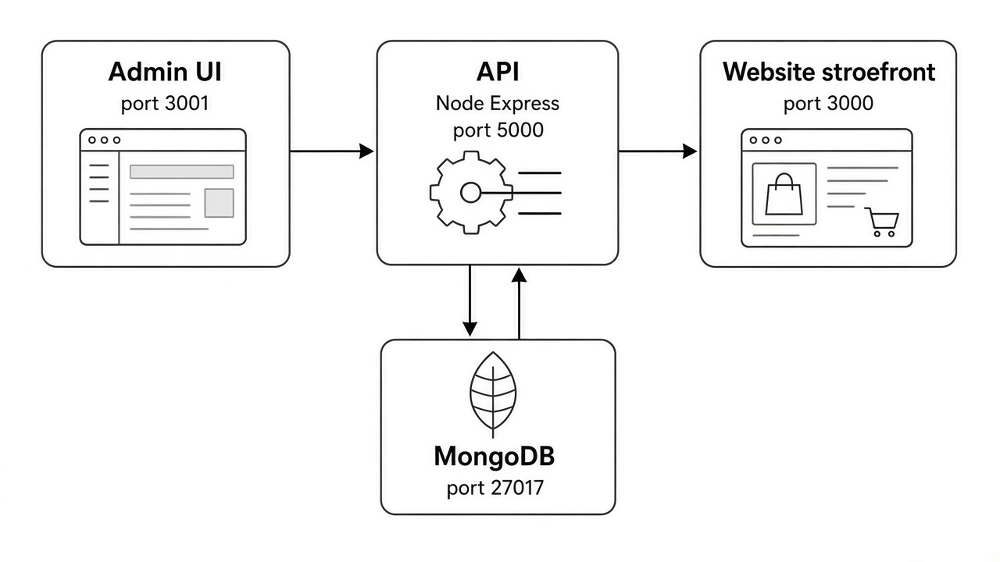
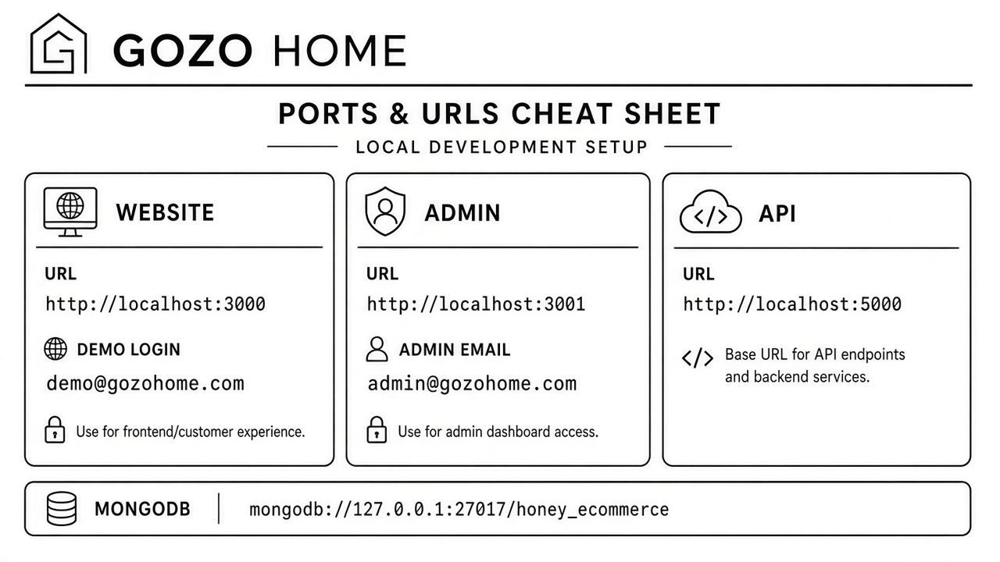
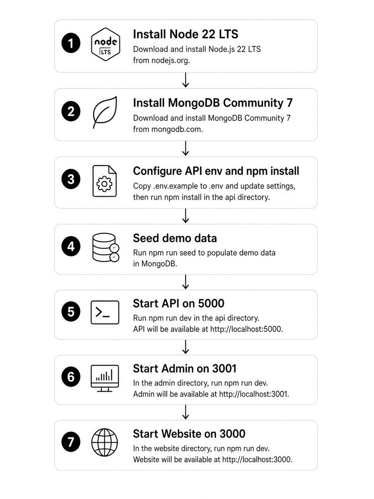

# GOZO HOME — Start here

You received the **source code** for three apps. Follow this pack to install and run them **on your own computer**.

| App | Folder | What it is | Local URL |
|-----|--------|------------|-----------|
| **API** | `original_partyBox_new_api` | Backend + database + images | http://localhost:5000 |
| **Website** | `original_HoneyEcommerce_new_ui` | Customer shop (storefront) | http://localhost:3000 |
| **Admin** | `Honey_admin_UI` | Staff panel (products, orders, …) | http://localhost:3001 |



## Read this guide

**Full picture guide (install versions + run each app):**  
→ **[CLIENT_LOCAL_RUN.md](CLIENT_LOCAL_RUN.md)**

**Quick cheat sheet:**

| Need | Value |
|------|--------|
| Node.js | **22 LTS or newer** (`node -v` → `v22.x`) |
| MongoDB | **Community 7.x** (or 6/8) listening on `27017` |
| Redis | **Not required** for local demo |
| Admin login | `admin@gozohome.com` / `Admin@123` |
| Storefront login | `demo@gozohome.com` / `Demo@123` |



## Start order (always)

1. Start **MongoDB**
2. Start **API** (port 5000) — seed once
3. Start **Admin** (port 3001) and/or **Website** (port 3000)



## Source zip

If you were given a zip, unzip it first so you see these three folders plus this `START_HERE.md`.

To rebuild a clean delivery zip from this repo (developers):

```bash
bash scripts/make-client-source-zip.sh
```

That writes `dist/gozo-home-source.zip` (source only — no `node_modules`, no secrets).
